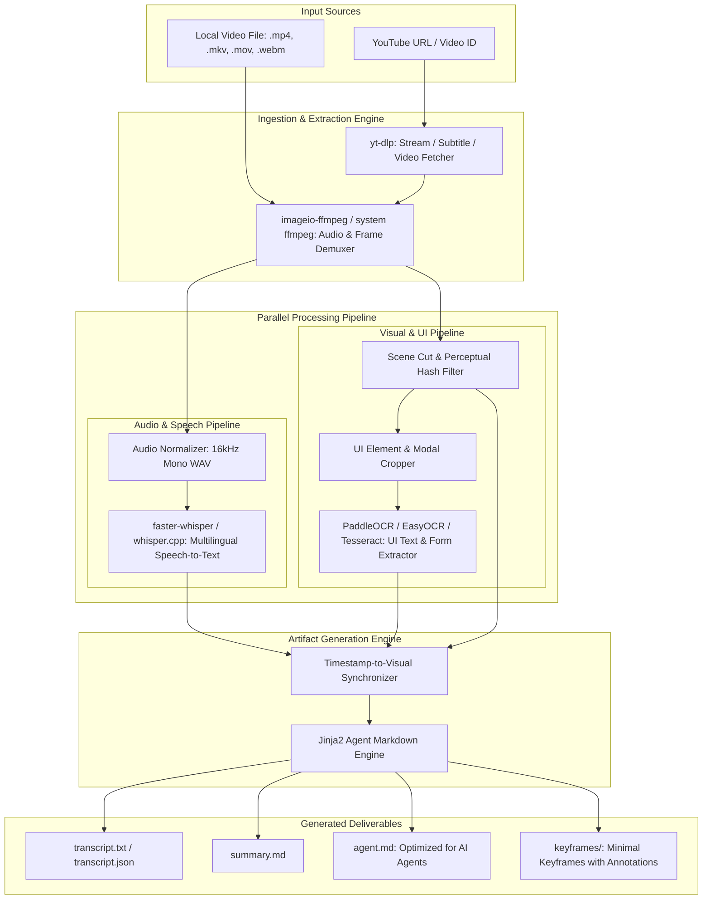

# Video-Analyzer: System Architecture & Design

## 1. Vision & Core Philosophy

**Video-Analyzer** is an open-source, local-first engine that transforms screen recordings, tutorials, and demonstration videos (local private files or public YouTube links) into highly structured, token-efficient intelligence artifacts for AI coding agents (Claude Code, Cursor, ChatGPT, Gemini, Antigravity).

### Why this project exists:
1. **Token Exhaustion on Free/Starter Tiers**: Passing raw video files or hundreds of 1080p frames to multimodal LLMs rapidly consumes 100k-500k tokens per query, instantly exhausting context windows and triggering rate limits. Video-Analyzer extracts the exact semantic essence into a compressed, high-density `agent.md` saving 85-95% of tokens.
2. **Zero Privacy Leaks (Local-First)**: Enterprise screen recordings frequently contain confidential customer PII, customer billing data, passwords, and internal URLs. Users should not be forced to upload unlisted/public videos to YouTube or third-party servers. All computation (audio extraction, Whisper ASR, scene detection, OCR) runs 100% locally on the user's machine.
3. **Multilingual & Code-Switching Intelligence**: Real-world walkthroughs often involve bilingual narration (Urdu/Hindi/Spanish mixed with English technical terms). Video-Analyzer uses Whisper's multilingual models with phonetic recovery to preserve technical terminology.
4. **Intelligent Keyframe Reduction**: Rather than naive interval sampling (e.g. 1 frame every second = 1800 images), Video-Analyzer uses changed-screen-area detection, settle detection, and perceptual hashing (pHash) to capture *only* meaningful UI changes such as page navigations, modals and dropdowns (~20-40 keyframes). See [3.3](#33-visual--ui-extractor-video_analyzerenginesvisionpy).

---

## 2. High-Level Architecture

---

## 3. Component Breakdown

### 3.1 Ingestion Layer (`video_analyzer/handlers/`)
- **Local Ingest**: Accepts local file paths (`.mp4`, `.mkv`, `.mov`, `.webm`) and checks that OpenCV can decode frames; the audio stream is probed with the bundled ffmpeg (`imageio-ffmpeg`).
- **YouTube Ingest**: Uses youtube-transcript-api and yt-dlp. If captions already exist in the target language, they replace Whisper transcription entirely. The video itself is downloaded at up to 720p for keyframes (skipped for `--format transcript` when captions exist). If YouTube blocks the download ("confirm you're not a bot"), `--cookies-from-browser` / `--cookies` pass a login to yt-dlp; when captions were fetched, the run continues without keyframes.

### 3.2 Speech-to-Text Engine (`video_analyzer/engines/audio.py`, `asr.py`)
- Audio is extracted to a 16 kHz mono WAV and passed to `faster-whisper` (CTranslate2) as samples.
- Uses CUDA (float16) when available and falls back to CPU (int8) when CUDA is missing or fails mid-run. See [GPU_SETUP.md](./GPU_SETUP.md).
- Auto-detects spoken languages (Urdu, Hindi, Spanish, English, etc.); VAD filtering skips silence.
- Produces sentence-level segments `[{start, end, text, confidence, language}]`.

### 3.3 Visual & UI Extractor (`video_analyzer/engines/vision.py`)
- **Keyframe Extraction**:
  - Frames are sampled at 1 fps and reduced to 256 px-wide blurred grayscale thumbnails.
  - **Difference score** against the last kept keyframe: the thumbnail is split into a 16 px grid; a cell counts as changed when more than 3% of its pixels changed by more than 25 gray levels (above compression noise). The score is `sqrt(changed cells / all cells)`: 0 is identical, 1 is a completely different screen.
  - **Why not SSIM:** whole-image metrics such as SSIM are dominated by the unchanged whitespace of typical UIs. In testing, full page navigations scored only 0.07-0.15 as `1 - SSIM`, so a 0.35 threshold missed them. The changed-area score gives a usable range:

    | Screen change | Score |
    | :--- | :--- |
    | Cursor movement | ~0.08 |
    | Typing into a field | ~0.25 |
    | Opening a dropdown | ~0.35 |
    | Navigating to another page | 0.4-0.6 |
    | Modal with dimmed backdrop | ~0.95 |

    The default `--keyframe-threshold 0.35` therefore means roughly "at least 12% of the screen changed". Lower it for more keyframes.
  - **Settle detection:** once the threshold is crossed, the frame is not saved immediately. The extractor waits until two consecutive samples differ by less than 0.15 (or 3 seconds pass), so scrolls, fades and animations are captured in their final state. The keyframe is stamped with the time the change *began*, so step boundaries in `agent.md` line up with the narration.
  - **Duplicate filter:** a 64-bit pHash of each new keyframe is compared with all earlier ones; a Hamming distance of 4 or less means the user returned to a screen already captured, and it is skipped.
  - **Cap:** at most 40 keyframes (the first frame plus the highest-scoring changes) keep `agent.md` within the token budget. Images are saved as JPEG at up to 1280 px wide.
- **OCR & Field Extraction** (`video_analyzer/engines/ocr.py`, optional `[ocr]` extra):
  - EasyOCR on each keyframe extracts button labels, table headers, form inputs, URLs and status badges, in reading order.

### 3.4 Artifact Generator (`video_analyzer/synthesis/`, `video_analyzer/templates/`)
- **`transcript.txt`**: Raw chronological transcript with timestamps.
- **summary.md**: Executive summary (What is this video? What is the goal? What systems are involved?).
- **`agent.md`**: The crowning deliverable. A structured technical brief designed specifically for LLMs:
  - Step-by-step numbered instructions.
  - Exact input field names, button labels, and expected outputs.
  - Data mapping tables (e.g. Source Field -> Target CRM Field).
  - Business logic & edge-case rules extracted from voiceover.
  - File/code templates for immediate implementation.

---

## 4. Privacy & Ephemeral Storage Contract
1. **Zero Data Retention**: Uploaded/local videos are read directly from local disk. Intermediate audio (`.wav`) and downloads live in a system temp folder and are purged when the run ends, unless `--keep-temp` is specified (then they are moved to `<output>/_temp`).
2. **Local Execution**: No video or audio is ever sent to external cloud APIs by default. The entire pipeline works completely offline on Windows, Linux, and macOS.
