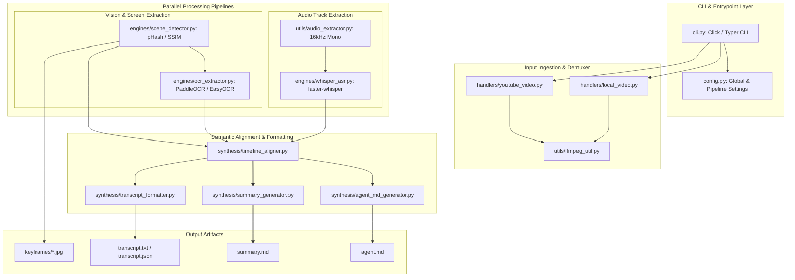
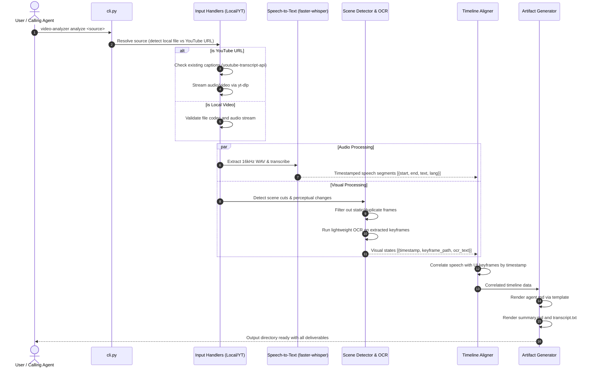
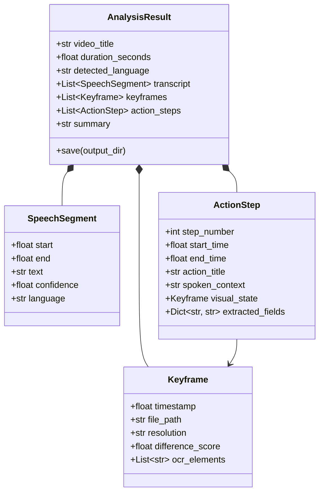

# GRAPHIFY.md: Component Topology & Data Flow Graph

This document provides a visual knowledge graph and architectural model for the **Video-Analyzer** system.

---

## 1. System Component Graph

---

## 2. Data Flow & Sequential Pipeline

---

## 3. Data Contract / Internal Schemas

